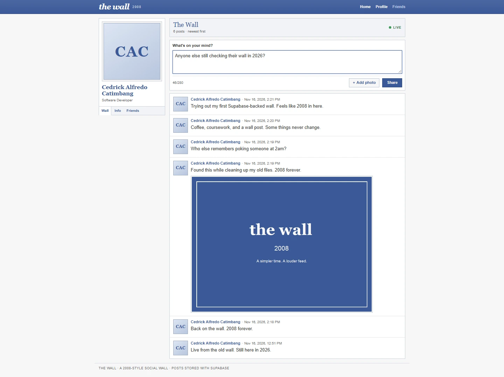
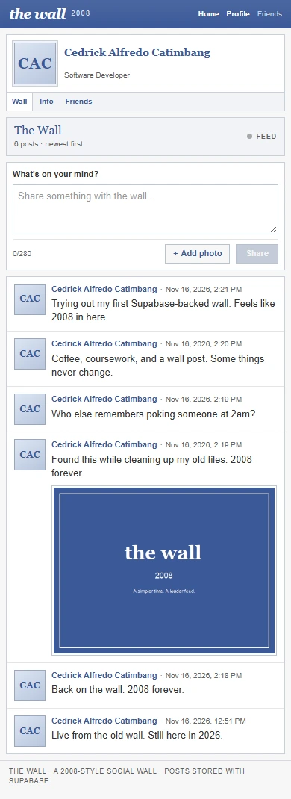

# The Wall

A small 2008-style social wall built with Next.js 16, React 19, TypeScript, Tailwind CSS 4, and Supabase.

Live: https://my-wall-coral.vercel.app

[Source](https://github.com/Calfredo23/my-wall)

Type a message, press **Share**, and it appears at the top of the feed. Posts are stored in Supabase and remain after a refresh. Realtime updates the feed without reloading.

## Required behavior

- A visitor can write a message and press Share.
- The post is saved in the `posts` table in Supabase.
- The feed is newest-first and persists after refresh.

Included extras: 280-character limit and Supabase Realtime.

## Screenshots

| Desktop | Mobile |
|---|---|
|  |  |

## Supabase setup

1. Create a Supabase project.
2. Open the SQL editor and run `supabase/schema.sql`.
3. In **Project Settings → API**, copy the project URL and the publishable key
   (`sb_publishable_...`). The legacy anon key also works.
4. Put them in `.env.local` (copy `.env.example`):

```bash
NEXT_PUBLIC_SUPABASE_URL=https://your-project.supabase.co
NEXT_PUBLIC_SUPABASE_PUBLISHABLE_KEY=your-publishable-key
# Legacy alternative: NEXT_PUBLIC_SUPABASE_ANON_KEY=your-anon-key
```

5. In **Database → Replication**, confirm `posts` is in the realtime publication.
6. Optional: run `supabase/demo-posts.sql` to replace E2E rows with a small demo feed.
7. Restart `npm run dev`.

The app does not commit keys. Use the names above in Vercel as well.

## Scripts

```bash
npm run dev
npm run build
npm start
npm run typecheck
npm run lint
npm test
npm run test:e2e
npm run verify
```

Playwright uses port 3212. Supabase E2E tests are skipped unless the two `NEXT_PUBLIC_SUPABASE_*` variables are set.

## How it works

- `app/page.tsx` renders the wall.
- `components/wall.tsx` owns the feed state, initial fetch, insert, and Realtime subscription.
- `lib/posts.ts` holds validation, parsing, sorting, and deduplication.
- `lib/supabase/client.ts` creates the browser client from public env names.
- The database enforces the 280-character rule and RLS allows public read/insert only.

## License

MIT © Cedrick Alfredo Catimbang
